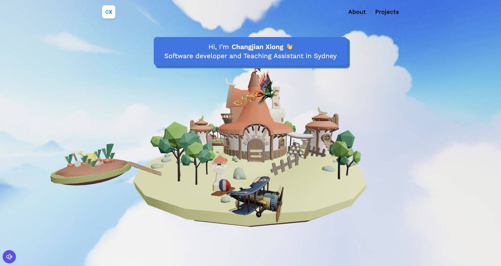

# Changjian Xiong — 3D Portfolio

Changjian (Edward) Xiong’s personal portfolio brings together software projects, teaching at Macquarie University, and robotics research. The homepage is an interactive 3D island. Drag across the scene or use the left and right arrow keys to rotate it.

**[Visit the live portfolio](https://changjianxiong.com/)**

[](https://changjianxiong.com/)

## Explore the site

| Page | What you’ll find |
| --- | --- |
| [About](https://changjianxiong.com/about) | Work and teaching experience, technical skills, and education |
| [Projects](https://changjianxiong.com/projects) | ZeroNet, robotic arm and dexterous hand research, this portfolio, and CROWN CLOTHING |
| [Contact](https://changjianxiong.com/contact) | An EmailJS contact form with a direct email link |

The site uses React and React Router, with Three.js and React Three Fiber for the 3D scenes, Tailwind CSS for styling, and Vite for the development server and production build.

## Run locally

Use Node.js and npm. The production build was verified with Node.js 24.

```sh
git clone https://github.com/edwardxcj/3d-portfolio.git
cd 3d-portfolio
npm ci
npm run dev
```

Open the local URL printed by Vite. The contact form needs the EmailJS settings below to send messages.

## Set up contact email

1. Copy [`.env.example`](.env.example) to `.env.local`. Set `VITE_APP_EMAILJS_SERVICE_ID`, `VITE_APP_EMAILJS_TEMPLATE_ID`, and `VITE_APP_EMAILJS_PUBLIC_KEY` from the [EmailJS dashboard](https://dashboard.emailjs.com/).
2. Connect and test the email service. Set the template’s **To Email** to the recipient’s address, use the service’s default sender, and set **Reply To** to `{{from_email}}`. Use `{{from_name}}` and `{{message}}` to show the visitor’s name and message.
3. Submit a test message at `/contact` and confirm delivery and the reply address. Check **Email History** in EmailJS if delivery fails.

Vite includes `VITE_*` values in the browser bundle. Use the EmailJS public key there and set the same variables in the production build environment.

## Build and deploy

```sh
npm run build
npm run preview
```

The build writes to `dist/`. The live site is served as static files on Hostinger. Publish the contents of `dist/` to `public_html` and configure the host to serve `index.html` for direct visits to `/about`, `/projects`, and `/contact`.

## Credits

- The original 3D portfolio template is from [JavaScript Mastery](https://github.com/adrianhajdin/3D_portfolio).
- The island scene uses [Fox’s Islands](https://sketchfab.com/3d-models/foxs-islands-163b68e09fcc47618450150be7785907) by [nimzu](https://sketchfab.com/nimzuk), under [CC BY 4.0](https://creativecommons.org/licenses/by/4.0/).
- The [phoenix](https://sketchfab.com/3d-models/phoenix-bird-844ba0cf144a413ea92c779f18912042) and [fox](https://sketchfab.com/3d-models/fox-f372c04de44640fbb6a4f9e4e5845c78) models are from Sketchfab.
